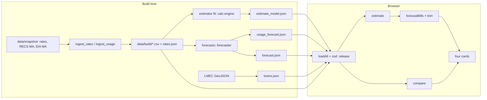

# Design Document

## Overview

FairWatt Home is a static Next.js site (`output: 'export'`) that evaluates small, pre-fitted JSON models in the browser. All fitting and backtesting happens at build time in Python or TypeScript, producing five validated JSON files in `public/data/`. The browser loads them, validates them with zod, and runs pure functions. Deterministic code computes every number; language-model text is never used for figures.

Key decisions (rationale in `docs/superpowers/specs/2026-10-23-fairwatt-home-design.md`):
- **Estimate, don't fetch.** Usage cannot be looked up from an address; we fit on public survey data and let the user refine.
- **Bands over points.** The fit explains about a third of household variation (weighted R² 0.34), so P10–P90 ranges are shown.
- **Ship rules decide labels.** Each forecast ships only if it beats its baseline; otherwise the baseline ships with an honest label.
- **Fail closed.** Missing data, stale rates or out-of-range inputs produce an explanation, never a guess.

## Architecture

## Components and Interfaces

All types are in `contracts/types.ts` (version 1.2.0); JSON Schemas in `contracts/*.schema.json`.

| Component | Owner agent | Interface |
|---|---|---|
| Rate and usage ingest | orchestrator (scripts) / data-ingest | `ingest_rates.py`, `ingest_usage.py` → `data/build/` (gates G-DATA-1/2/3) |
| Town geometry | orchestrator (script) / geo-map | `build_geo.mjs` → `towns.json` (G-GEO) |
| Estimator fit | calc-engine | `fit_estimator` → `estimate_model.json` |
| Estimator evaluate | calc-engine | `estimate(home, model): EstimateOutcome` |
| Calculator | calc-engine | `compare(input, rates, today): CompareOutcome`; `formatUsd` |
| Bill math | calc-engine | `forecastBills(estimate, usageFc, rates, rateFc, utility, today): BillForecast`; `trim(bills, pct): TrimScenario` |
| Usage forecast | forecaster | K0/K1 → `usage_forecast.json` |
| Rate forecast | forecaster | M0–M2 → `forecast.json` |
| Data loader | release | `loadAll(): typed data or typed error` (zod) |
| UI | ui-builder + teammate | four cards, drawer, all states in `docs/specs/ui.md` §2 |
| Copy and claims | copy-compliance | `src/copy/strings.ts`, `docs/claims.md`, `research/sources.md` |
| Independent testing | verifier | `tests/e2e/`, `research/verification.md` |

## Data Models

`HomeInput`, `UsageEstimate`, `EstimateModelFile`, `UsageForecastFile`, `MonthBill`, `BillForecast`, `TrimScenario` (new in 1.2.0) alongside `RatesFile`, `ForecastFile`, `TownsFile`, `CompareInput/Result` (existing). Data dictionary: `docs/specs/data-dictionary.md`.

## Error Handling

- Hard input errors (`SQFT_OUT_OF_RANGE`, `USER_KWH_OUT_OF_RANGE`, `DUPLICATE_MONTH`, `RATE_OUT_OF_RANGE`, `KWH_OUT_OF_RANGE`, `UTILITY_MISSING`, `DATA_STALE`) block results with a plain explanation.
- Soft issues (`TOO_FEW_MONTHS`, `RATE_UNUSUAL`) show the result plus a note.
- Data load or validation failure shows one message and no numbers.
- A horizon month without a rate shows "rate not available" and withholds the total.

## Testing Strategy

- **Golden vectors by ID:** E1–E6 (estimator), B1–B4 and T1 (bills), G1a–G4 (calculator).
- **Property tests (fast-check, ≥ 500 runs):** monthly sums equal the annual value, ordering of percentiles, monotonic size effect, scaling, no NaN.
- **Leakage tests:** perturbing future data leaves earlier forecasts bit-identical, for both forecasts.
- **Data gates:** checksums and re-derived ground truth (`reference/verify_snapshot.py`, `reference/verify_usage.py`).
- **UI:** Playwright at 375 px light and 1280 px dark; no console errors, no horizontal scroll, keyboard path.
- **Independent verifier** recomputes values by hand and tries bad inputs.

## Kiro Workflow

- **Steering** (`.kiro/steering/`): product, tech, structure (file ownership), ground truth, agent rules. Always on.
- **This spec** is the plan; `tasks.md` is ticked as work lands.
- **Sub-agents** (`.kiro/agents/`): orchestrator delegates tasks by name to workers; gates are re-run by the orchestrator.
- **Hooks** (`.kiro/hooks/`): block destructive git commands in the shared working tree; validate each generated data file against its schema on save.
- **Evidence:** every commit is prefixed with its agent; `reference/kiro_usage_report.py` turns that into `docs/KIRO.md`.
