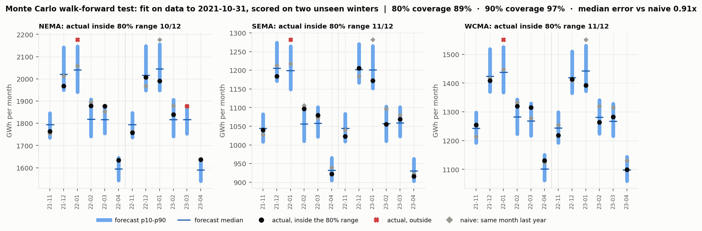

# Monte Carlo 6-month forecast: method and walk-forward test

Code: `backend/forecast/mc.py`. Output: `data/build/mc_forecast.json` (+ `mc_calibration_rows.json`). Gate: `python3 tests/backend/forecast/check_mc.py` (**PASS**).

## Method (per path, 10,000 paths, seed 20261024)
1. Weather: one historical Nov–Apr season (2017-18 … 2022-23), shifted −7…+7 days, shared by all zones.
2. Expected load: the same rolling 2-year weather model the HMM uses (temperature, weekend, calendar month).
3. Regimes: each zone's 3-state HMM switches states day by day; daily load = expected × (1 + residual %).
4. Level: × 1.0435 (EIA all-sector sales, 12 months to Aug 2026 ÷ 2023), because ISO-NE data ends in 2023.
5. Months summed; MA = the three zones summed per path.

## Walk-forward test (the honesty badge)
Fit on data up to **2021-10-31** only, then forecast two winters the model never saw (2021-11..2022-04 and 2022-11..2023-04), on their real calendars: **36 zone-months**.

- 80% range contained the actual: **89%** (target 80%: slightly cautious)
- 90% range contained the actual: **97%**
- Median error ÷ 'same month last year' error: **0.91** (≈ 9% better than the naive guess)
- Leakage test: scrambling all data after the cut leaves these forecasts bit-identical.

## Forecast, Nov 2026 – Apr 2027 (GWh)

| Area | 6-month p10 | median | p90 | same months 2022-23 × level |
|---|---|---|---|---|
| NEMA | 11,450 | 11,660 | 11,886 | 11,593 |
| SEMA | 6,701 | 6,805 | 6,929 | 6,721 |
| WCMA | 7,977 | 8,159 | 8,361 | 8,004 |
| MA | 26,226 | 26,611 | 27,102 | 26,317 |

## Limits
- Six weather seasons is a small library; extreme winters outside 2017–2023 are not represented.
- Zone residuals are simulated independently, so the MA band is probably too narrow.
- The 2023→2026 level comes from one EIA ratio; heat pumps and EVs change the shape too, which this does not model.
