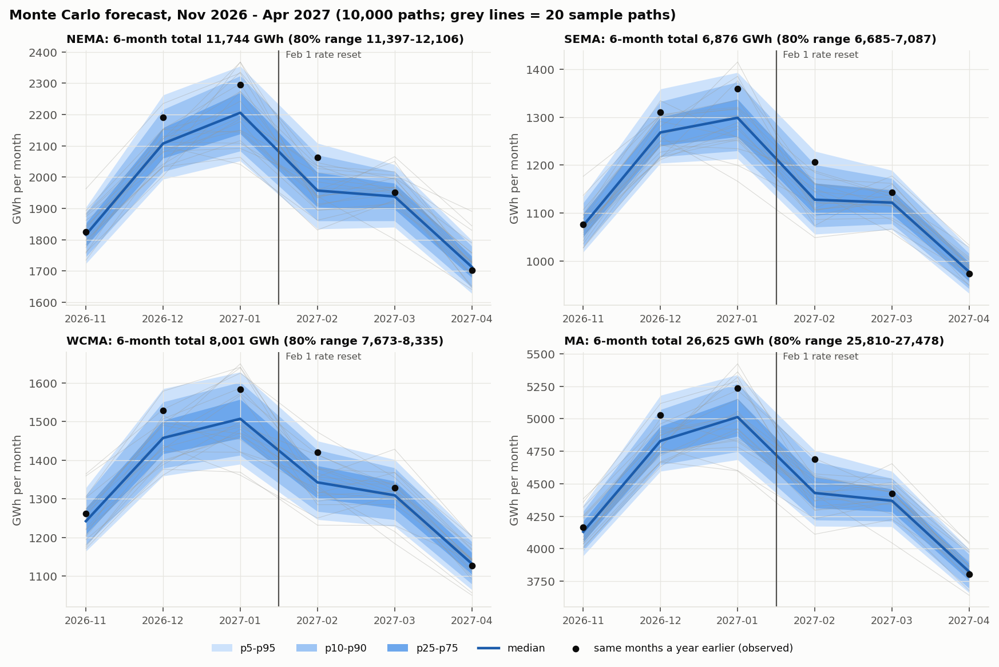

# Monte Carlo 6-month forecast: method and walk-forward tests

Code: `backend/forecast/mc.py`. Output: `data/build/mc_forecast.json` (+ `mc_calibration_rows.json`). Gate: `python3 tests/backend/forecast/check_mc.py` (**PASS**).
Inputs refresh daily (`backend/live/`, doc `docs/apis/11-live-grid-data.md`), so the horizon and every number below roll forward.

## Method (per path, 10,000 paths, seed 20261024)
1. Horizon: the 6 full calendar months after the last observed day (Oct 24 2026: data through Oct 14 → Nov 2026 – Apr 2027).
2. Weather: the same 6 months of one past year: every year the data covers, 2017 … 2025 today, shifted −7…+7 days and shared by all zones.
3. Expected load: rolling 2-year weather model fit to the last observed day (temperature, weekend, calendar month).
4. Regimes: each zone's 3-state HMM on its walk-forward residual (%), centred on zero, switches day by day.
5. Level: × (1 + the zone's mean residual over the last 365 days) × one shared shock per path with sd = how far that level
   has moved over 6 months, measured at every past month start (Oct 24: NEMA 1.0048 ± 1.8 %, SEMA 1.0081 ± 1.6 %, WCMA 0.9970 ± 2.6 %).
6. Months summed; MA = the three zones summed per path. "Same months last year" = the load observed a year earlier (no adjustment).

## Why steps 1, 5 and 6 changed on Oct 24 (live data)
With live EIA-930 load (S19) the series reaches the last published day, so the snapshot-era ×1.0435 EIA ratio is gone. The live
data also allowed a far bigger test. The earlier badge (one origin, two winters) turned out to be a lucky sample.

**Rolling-origin backtest:** refit on data ≤ Oct 31 before every complete winter, 2019-20 … 2025-26 (7 winters, 126 zone-months),
the way the live system is used. Apples to apples, same code and seeds:

| Variant | 80% band held | 90% band held | median error ÷ naive | 6-month total, mean \|miss\| | bias | totals inside 80% band |
|---|---|---|---|---|---|---|
| A: original (level 1, uncentred HMM) | 69 % | 83 % | 1.009 | 2.63 % | +0.87 % | 43 % |
| B: + recent level (365 days) | 73 % | 83 % | 0.965 | 2.27 % | +0.39 % | 48 % |
| **C: + level shock (shipped)** | **80 %** | **87 %** | **0.962** | **2.22 %** | **+0.35 %** | **57 %** |

naive = the same month last year. On the old fixed test (fit to 2021-10-31, scored on 2021-22 and 2022-23), A looked better
(89 % / 97 %, 0.912). C scores 89 % / 100 %, 1.065 there, because a level measured in 2020-21 is applied 12–18 months later. The
live system refits every day, so the rolling test is the one that matches its use. Lesson recorded: a gapped two-winter sample
overstated the method.

What the 7 winters show:
- Winter 2025-26 was the coldest of the nine in the data: NEMA HDD 5,094, vs 4,203–5,058 for the others.
- With last winter's actual weather, the model fit before it ran 2 % low (load growing ~2 %/yr). Step 5 exists to correct that.
- The 6-month total bands are still too narrow: they held 57 % of 21 zone-winters, about 7 independent winters. Read them as a
  floor on the uncertainty.

## Forecast, Nov 2026 – Apr 2027 (GWh; data through 2026-10-14)

| Area | 6-month p10 | median | p90 | same months a year earlier (observed) |
|---|---|---|---|---|
| NEMA | 11,397 | 11,744 | 12,106 | 12,027 |
| SEMA | 6,685 | 6,876 | 7,087 | 7,067 |
| WCMA | 7,673 | 8,001 | 8,335 | 8,250 |
| MA | 25,810 | 26,625 | 27,478 | 27,344 |

The median sits 2.6 % below last winter mostly because last winter was the coldest in nine years. Normal weather would bring less
heating load.

## Leakage and reproducibility (gate)
Scrambling all data after a cut leaves the cut's forecasts bit-identical; the same seed gives identical paths.

## Limits
- Nine weather years is a small library; a winter colder than 2017-18 or 2025-26 is not represented.
- Zone residuals are simulated independently (the level shock is shared), so the MA band may still be too narrow.
- The level step follows a trend with a lag of about six months; heat pumps and EVs change the shape of load too, which this does not model.
