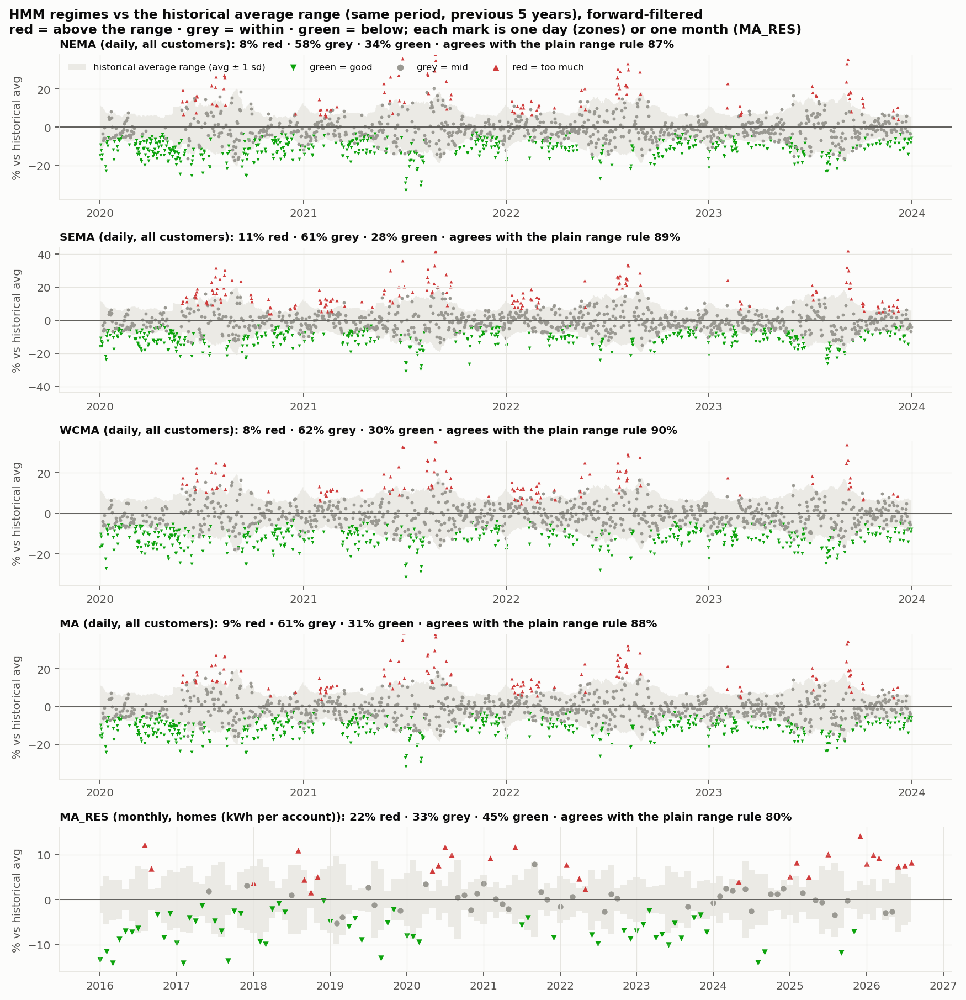
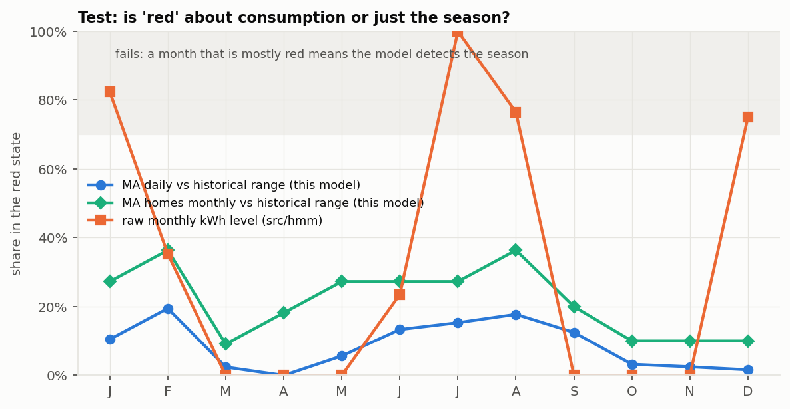
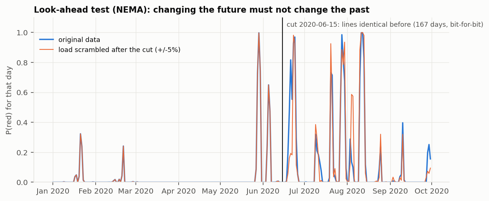
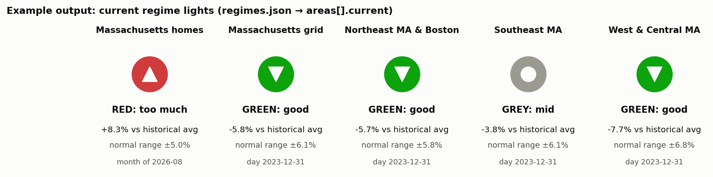
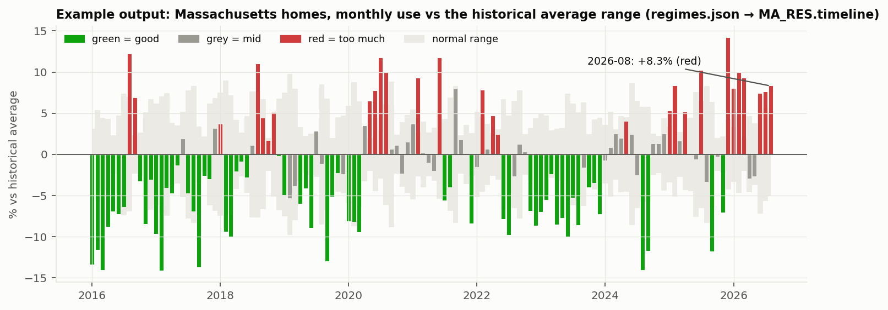
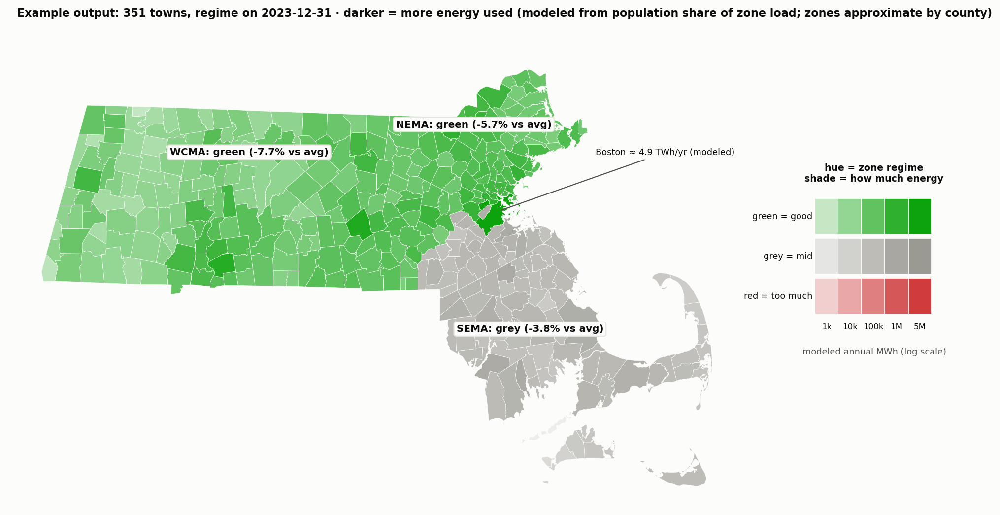

# HMM consumption regimes 🟢⚪🔴: method and test results

Code: `backend/regimes/` (hand-rolled 3-state Gaussian HMM, numpy only). Output: `data/build/regimes.json`. Gate: `python3 tests/backend/regimes/check_regimes.py` (**G-HMM: PASS**). Charts: `docs/img/tests/` and example outputs in `docs/img/examples/` (`python3 tests/backend/make_test_charts.py`).

## Definition (TC, Oct 24)
- 🔴 **red**: consumption **above** the historical average range (bad)
- ⚪ **grey**: **within** the historical average range
- 🟢 **green**: consumption **below** the historical average range (good)
- **Historical average range** = average ± 1 standard deviation of the **same period in the previous 5 years** (daily zones: the same day of year ± 7 days; homes: the same calendar month). Only earlier years are used, so no colour ever depends on later data.

## Series
- **NEMA, SEMA, WCMA, MA**: ISO-NE daily load (all customer classes), 2020-01-01 … 2023-12-31 (2017–2018 build the first range, 2019 warms up the HMM).
- **MA_RES**: statewide residential kWh per account (EIA-861M, 12-month mean of customers), monthly 2016-01 … **2026-08**: the up-to-date light.

## The HMM
z = (value − historical average) ÷ historical sd. Three states with means **anchored at −1.5 / 0 / +1.5 sd** (below / within / above the ±1 sd range), so every colour means exactly the definition; the HMM learns the persistence (no day-to-day flicker) and the spread (daily zones; anchored at 0.6 for the 128-month home series, where it can't be learned reliably). Refit every month on past data only; states are forward-filtered. z is clipped at ±3 for fitting only.

## Test results

| Area | unit | green / grey / red share | agreement with the plain above/within/below rule | current (date: colour, % vs avg, range) |
|---|---|---|---|---|
| NEMA | day | 34% / 58% / 8% | 87% | 2023-12-31: **green**, -5.7%, ±5.8% |
| SEMA | day | 28% / 61% / 11% | 89% | 2023-12-31: **grey**, -3.8%, ±6.1% |
| WCMA | day | 30% / 62% / 8% | 90% | 2023-12-31: **green**, -7.7%, ±6.8% |
| MA | day | 31% / 61% / 9% | 88% | 2023-12-31: **green**, -5.8%, ±6.1% |
| MA_RES | month | 45% / 33% / 22% | 80% | 2026-08-01: **red**, +8.3%, ±5.0% |

- **No look-ahead:** scrambling load after a cut date leaves every earlier range, z and state bit-identical (daily: 167 days; monthly: 66 months).
- **Not a season detector:** no calendar month is mostly red in any area (the raw-level HMM in `src/hmm/` makes every July red and every April green).
- Many green days in 2020–2023 are real: grid consumption ran below the 2015–2019-era range (COVID, efficiency, rooftop solar). Homes in 2025–2026 run above their range (red).

## Example outputs (what the UI can show)

## Limits
- Weather is not removed: a heat wave or cold snap that pushes use above the range is red (that is the definition).
- ISO-NE daily data ends 2023-12-31; MA_RES is current to 2026-08. Zone membership of towns is approximate (by county: e.g. Brookline, in Norfolk, shows as SEMA on the map).
- With anchored states the HMM agrees with the plain rule 80–90% of the time; the rest are short excursions the HMM treats as noise inside a persistent regime.
